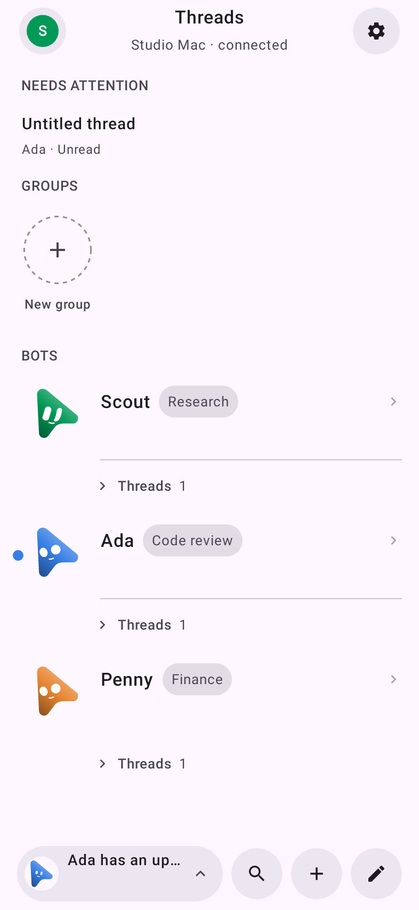
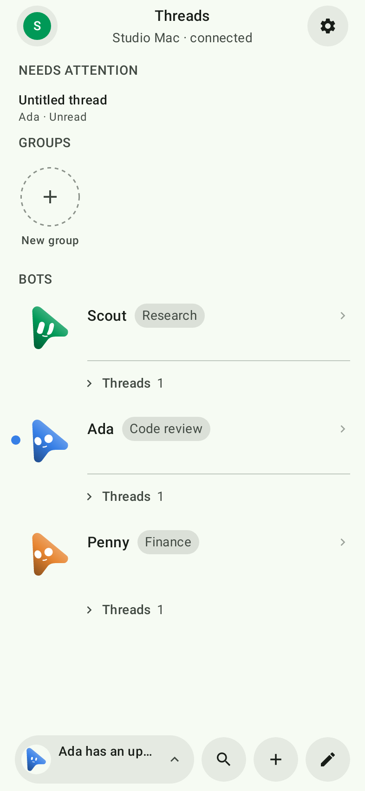
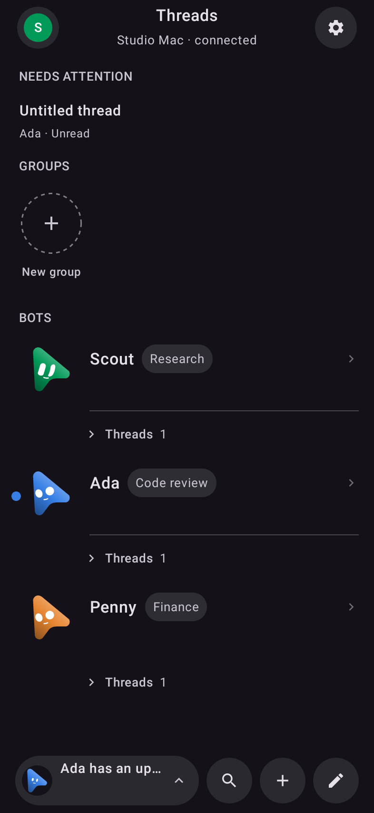
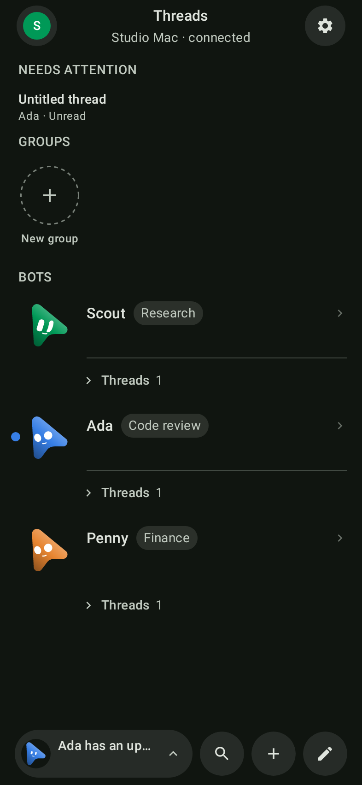
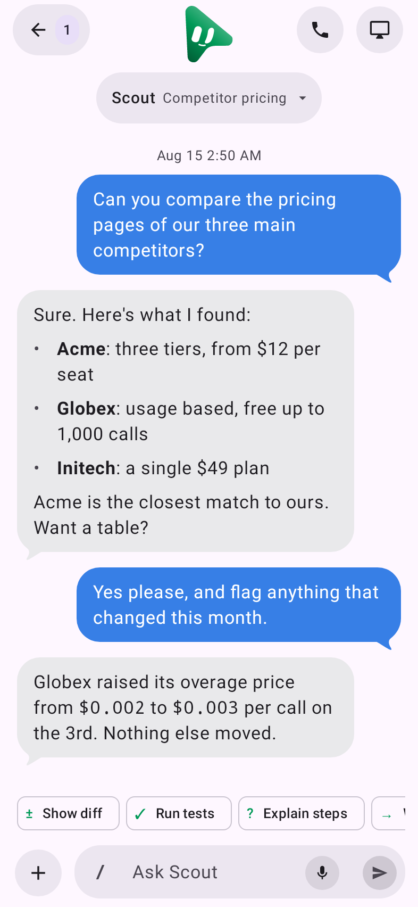
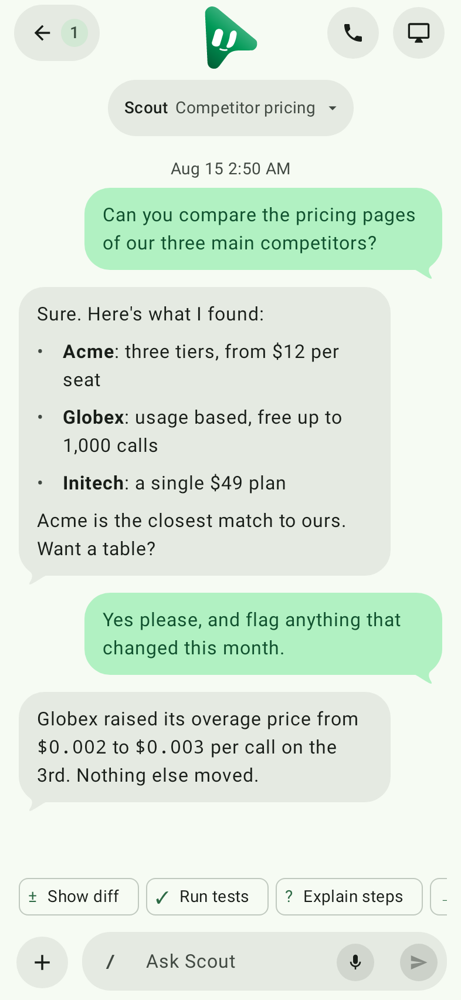
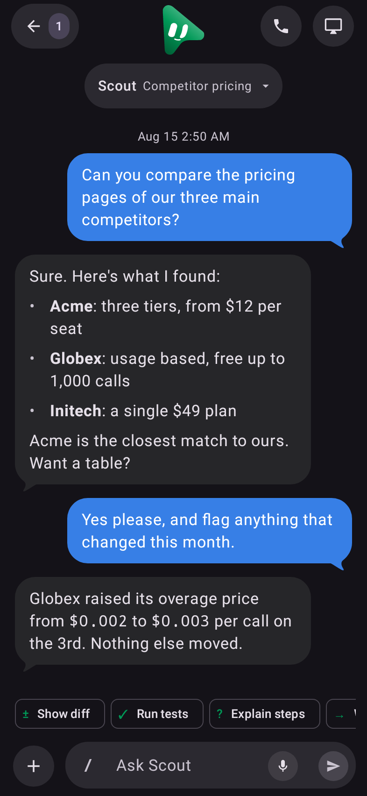
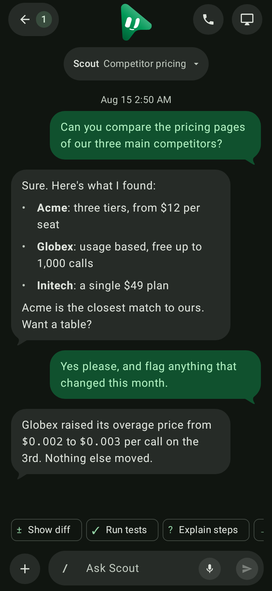

# Phase 1: Material You theme

Rendered by `ScreenshotTest` (Robolectric, no device) with the brand fallback
scheme, which is what Android 8–11 shows. On Android 12+ the same screens take
their colours from the wallpaper.

| | Before (v1.5.0) | After |
|---|---|---|
| Threads, light |  |  |
| Threads, dark |  |  |
| Chat, light |  |  |
| Chat, dark |  |  |

Regenerate with:

```sh
./gradlew :app:testDebugUnitTest --tests 'com.openmausbot.companion.ui.ScreenshotTest'
# → app/build/screenshots/
```
